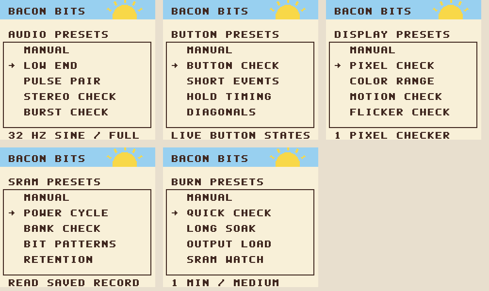

# Bacon Bits

A Game Boy diagnostic cartridge with an original sunrise browser and eight tests:

- **Platform Detect:** hardware class, twelve emulator probes, known signatures,
  and the actual reads behind each result.
- **Link Sustain:** sustained packets, shared simulation, scene barriers,
  uneven CPU load, and retained errors from Link Sustain v1.2.
- **Rumble Pulse:** editable patterns, presets, frame and millisecond timing,
  start/stop sweeps, and prespin.
- **Audio Range:** both pulse channels, six waveforms, two noise widths,
  stepped or fine frequencies, levels, stereo routing, and timed bursts.
- **Buttons:** live button states, press counts, longest holds, short presses,
  short release gaps, and the largest simultaneous chord.
- **Display:** solid colors, grids, checkerboards, stripes, color ramps,
  scrolling bars, and flicker.
- **SRAM Test:** write/verify patterns, bank tags, repeated passes, and
  verification after a power cycle.
- **Burn In:** repeated ROM checksums, a 256-byte scratch RAM check, elapsed
  time, and optional audio, rumble, and read-only SRAM checks.


The six-pixel bitmap lettering, icons, and sunrise art are original drawings. The colors are blue sky,
yellow sun, cream, toast brown, and bacon red. The interface also works in
monochrome. Reference cartridges supplied for comparison are excluded from Git.

## Controls

Left/Right browses tests; A opens one. Returning keeps the selected test.
Up/Down selects a setting, Left/Right changes it, and Select changes pages.
A starts a test; B stops it or backs out. A destructive confirmation starts
on NO.

Hold A+B+Start+Select together to open the return menu on Platform Detect,
in Link Sustain's settings or stopped results, or while Rumble Pulse is idle.
CONTINUE is selected first. Choose TEST MENU to return to the browser.
Buttons uses the same chord held for at least 60 frames, allowing each button
to be tested separately.

Link Sustain stops with B and returns to its settings with Start. Fast link
clock and double CPU speed require color hardware. Rumble Pulse uses Start
to play/stop, B to change mode, and Select combinations for settings.
Exit switches the motor off and restores normal CPU speed.

## Presets and follow-up checks



Audio, buttons, display, SRAM, and burn-in open with four scenario presets
and a manual option. Choosing a preset opens its settings before it runs.
On later visits, CONTINUE is selected and preserves customized settings.
Link Sustain retains its five test profiles; Rumble Pulse retains ten presets.
Platform Detect always runs the same twelve observational probes.

| Test | Presets |
| --- | --- |
| Audio | Low end, pulse pair, stereo check, burst check |
| Buttons | Button check, short events, hold timing, diagonals |
| Display | Pixel check, color range, motion check, flicker check |
| SRAM | Power cycle, bank check, bit patterns, retention |
| Burn-in | Quick check, long soak, output load, SRAM watch |

Low end starts at a 32 Hz sine at full wave level. Pulse pair starts at
440 Hz with 50 percent duty; either pulse can be selected. Stereo starts
on the left output. Burst check uses triangle waves with 30-frame gaps.
Output load opens the audio/rumble settings so those choices are visible
before starting. SRAM scenarios still require confirmation before any write.

Bacon Bits keeps evidence for follow-up checks: probe reads behind a host
signature, separate short press/gap counts, exact audio divisors and wave
RAM, the first failing memory location, and a saved SRAM configuration.
Burn-in combines repeatable loads and retains its first failure across
later cycles. These records support comparisons that a static pattern or
a single pass/fail screen cannot describe.

## Platform evidence

Select opens details from the original Platform Detect v1.4 summary.
Left/Right chooses a probe; A switches between failed probes and all twelve.
Select switches between probes and the name evidence; B restores the summary.
Each probe shows its expected bytes, captured reads, pass/fail result, and
what it checks. KEY1 compares the unused-bit mask; RP accepts three known
values. Monochrome hardware reports that the CGB probes do not apply.

The name page shows the rule that matched and its captured inputs. Name
matching follows the original ordered signature rules. A named emulator can
pass all twelve probes, and an unknown signature can still fail probes.
These are observed register signatures, not a guarantee of host identity.

## Audio Range

Page one selects VOICE, HZ/CLOCK, LEVEL, and OUTPUT. Page two selects SHAPE,
STEPS, ON FR, and GAP FR. A toggles playback; B silences the APU and returns.
Playback starts silent. The graph previews the selected waveform; it does
not measure the sound output.

Each pulse has 12.5, 25, 50, and 75 percent duty. Wave offers sine, square,
triangle, ascending saw, descending saw, and 25 percent pulse. Noise offers
15-bit and 7-bit LFSR modes. Sweep and volume envelopes are disabled.

Pulse frequencies span 64-131,072 Hz; wave spans 32-65,536 Hz. PRESET has
34 steps, with more at the low end. FINE changes the actual 11-bit frequency
register one unit at a time across all 2,048 settings. Frequencies come from
the hardware divisors. Pulse and noise have levels 0-15; wave has mute,
quarter, half, and full level. OUTPUT selects both stereo outputs, left, or right.
Use headphones to compare stereo separation.

Noise offers all 60 distinct running LFSR clocks, from 4.57 to 524,288 Hz.
CLOCK is the shift rate. At the lowest clock, the first change can take
several seconds. Above-hearing settings remain available for comparisons.

ON FR is HOLD or 1-120 software-timed frames. GAP FR is 0-120 frames.
A nonzero gap repeats bursts; zero gap ends playback after one burst.
Settings changes restart the burst. Frame gates follow the diagnostic's
polling loop; they are not hardware length-counter measurements.
Speaker response and low-frequency audibility require listening on hardware.

## Buttons and display

Buttons has live, count, timing, and diagonal pages. Left/Right selects a button on the
count or timing page. Timing separates short presses from short release gaps;
Up/Down sets their threshold to 1-8 frames. A changes hold units between
frames and milliseconds. Start opens the clear-counts confirmation.
The diagonal page counts each corner separately and tracks its longest hold.
A switches between entry counts, hold frames, and hold milliseconds. Filled
markers show the current diagonal. Opposite-direction reports have their own
counter. Presets preserve counters; clearing them still needs confirmation.
Input is sampled by software. The test cannot measure electrical contact
bounce or an event shorter than its polling interval.

Display settings include six colors, widths of 1/2/4/8/16 pixels, horizontal
or vertical orientation, scroll speed of 1-8 pixels per frame, inversion,
and a flicker interval of 1-60 frames. A opens the full LCD pattern.
Left/Right changes patterns, Select inverts, and B restores settings.
The color ramp shows all 32 component levels in 128 vertical pixels.
Monochrome hardware shows its four shades.

## SRAM and burn-in

SRAM starts in read-only VERIFY mode. WRITE and CYCLE require confirmation
and erase the selected cartridge RAM banks. Select 1/2/4/8 banks, eight data
patterns, a seed, 1/10/100/continuous passes, and a 0-30 second pause.
WRITE writes once, then verifies. CYCLE writes and verifies each pass.
Patterns include zero, ones, 55, AA, walking one/zero, address, and seeded data.
Sixteen bytes per bank hold distinct tags to expose bank aliasing.

A 32-byte record area at bank 0 offset 8160 is excluded from pattern data.
Its checked record identifies the last completed write's configuration.
After a power cycle, VERIFY uses that record. Missing or invalid records
report UNKNOWN. Results retain the first failing bank, decimal offset,
expected byte, and actual byte. Stopping a verification does not report PASS.
Eight banks cover 65,504 pattern bytes plus the reserved record area.

Burn-in offers 1/5/10/30/60 minutes or continuous operation, three loads,
normal/double CPU speed, and stop/continue on failure. It compares CRC-16
checksums for all eight ROM banks and writes/reads 256 bytes of scratch RAM.
The expected-checksum table and cartridge global checksum are excluded from
the ROM CRCs. The scratch check does not test all work RAM.
Audio and short rumble pulses are optional and default off. SRAM verification
is read-only and reports when no test record exists. Results retain the first
failure while later cycles continue. The failure page names ROM, scratch RAM, or SRAM and gives the location. Elapsed time follows VBlank ticks at either CPU speed.

## Build

Requires GBDK-2020 4.5.0, Python 3, and Pillow:

```sh
python3 -m venv .venv
. .venv/bin/activate
pip install Pillow pyboy==2.8.1 numpy
make GBDK_HOME=/path/to/gbdk/ PYTHON=python
```

`make release` updates `Bacon Bits (World).gbc` from `build/bacon-bits.gbc`.
This original diagnostic ROM is distributed with its source. The cartridge
is 128 KiB, MBC5+RUMBLE+RAM+BATTERY, with 64 KiB of cartridge RAM.
Flash hardware must support that mapper and RAM size; rumble needs a motor.
GBDK's RAM-bank shortcut omits the eight-bank size, so the build explicitly
sets header byte 149 to 05 and checks it after linking.
Reference ROMs, saves, environments, and test artifacts are excluded from Git.

`vendor/README.md` records the imported source revisions. Generated adapters
add banking, observations, and return hooks without changing vendored source.
The assembly entry and return gate are checked against current link symbols.
The browser uses 195 background tile slots, two palettes, and no sprites.
Buttons uses up to tile 223; display ramps use all eight background palettes.
The build checks ROM bank bounds and independently checks the CRC table.

## Verification

```sh
python tests/upstream.py
python tests/smoke.py
python tools/check_build.py
python tests/modal_regression.py
python tests/link_combined.py
python tests/rumble_combined.py
python tests/audio_ui.py
python tests/audio_backend.py
python tests/audio_shapes.py
python tests/additions.py
python tests/burn_faults.py
python tests/sram_patterns.py
python tests/presets.py
python tests/feature_regression.py
python tests/lettering.py
python tests/diagonals.py
python tests/rumble_return.py --core /path/to/sameboy_libretro.so
python tests/sameboy.py --core /path/to/sameboy_libretro.so
python tests/audio_sameboy.py --core /path/to/sameboy_libretro.so
python tests/additions_sameboy.py --core /path/to/sameboy_libretro.so
```

The standalone suites rebuild all three imported diagnostics. The combined
ROM also runs Link Sustain's feature/paired suites and the original rumble
timing suite. Paired link tests use synthetic byte transport and do not
establish physical cable timing.

PyBoy exercises color and monochrome UI, probe evidence, counters, display
patterns, a battery-file power cycle, SRAM fault reporting, and burn-in.
Audio checks cover every preset and level, waveform RAM, fine steps, timed
gates, stereo routing, 64 Hz pulse/32 Hz wave captures, and mute.
Fault injection changes SRAM data and unused ROM padding to check failures.

SameBoy checks palette output, tile maps and attributes, transitions, wave
RAM, stereo audio captures, motor-control output, and CPU-speed restoration.
Emulator captures do not establish speaker response, physical motor strength,
cartridge timing, battery retention, or hardware reliability.
SameBoy 26a56bd builds with `make libretro`, RGBDS, and `hexdump`.
Test evidence is written under `build/`.
