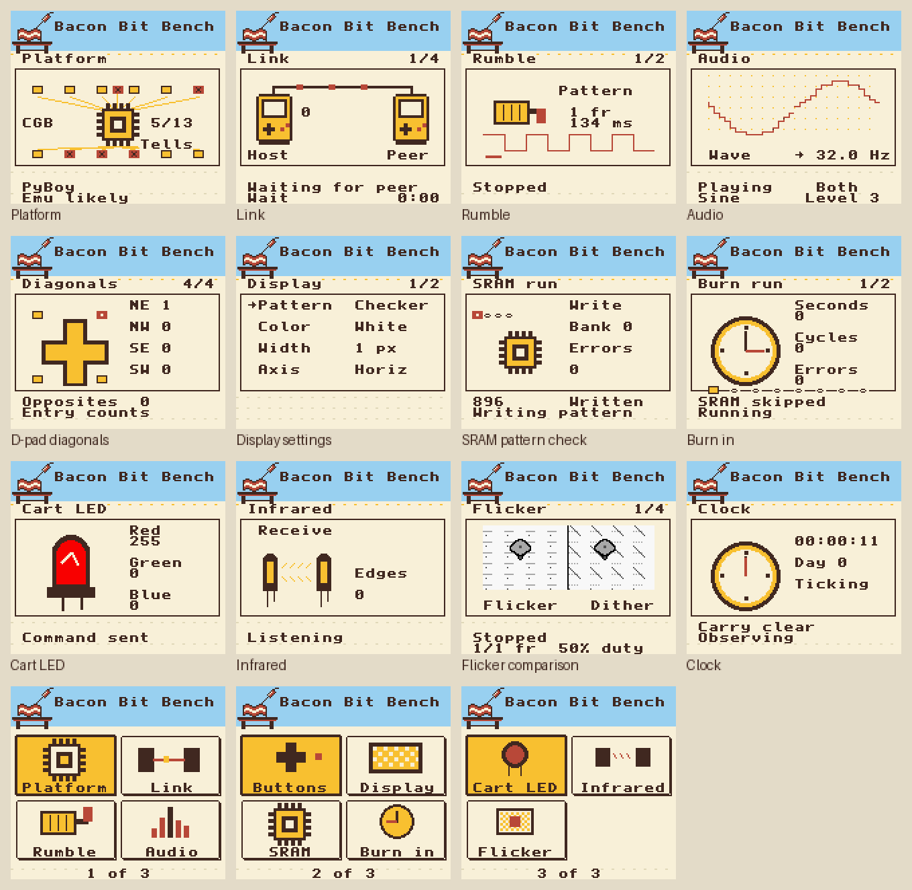

# Bacon Bit Bench

A test bench for the Game Boy and Game Boy Color. It has eleven instruments,
and each one exposes its settings: pulse lengths, frequencies, phase timing,
memory patterns and loads. Set the exact condition, then watch what the
hardware does with it. Everything works in color and in monochrome.

> Developed with Claude and Codex.



[Menu and live buttons](assets/controls.png) | [Flicker phases](assets/flicker.png)

## Why it exists

I patch and build Game Boy games, and I kept needing to measure things that
existing test cartridges could not be set to do. They check whether a part
works. I needed to know how it behaves at a setting I chose:

- How many frames a flash cart's rumble motor needs before it starts, and how
  long a gap it coasts through.
- Whether a link cable holds up under sustained traffic while each console
  carries a different CPU load, at each wire clock and CPU speed.
- How a display shows alternating frames at a set duty, next to a static
  dither at the same average.
- Which frequencies a speaker can still play, down to 32 Hz, one voice at a
  time.

Some of these started as one-off test ROMs for a single game. One measured
flash cart motors while I patched Pokemon Pinball's rumble. Another stressed
the link cable while I tried patches for an unreleased game. A third told
emulators from real hardware. Each made sense on its own, and together they
made sense as one cartridge, so the rest of the instruments were written to
join them on one menu with the same controls.

## The instruments

| Test | Settings and readings |
| --- | --- |
| Platform | Twelve CGB register probes with the bytes read back, the hardware class, and a match against known emulator signatures |
| Link | Host or peer, five traffic profiles, pacing, wire clock and CPU speed. Keeps the first failure with its expected and received values |
| Rumble (MBC5) | An 8-bit pattern, bit length in frames or milliseconds, on and off sweeps, prespin, burst length and gap |
| Clock (MBC3) | Live ticks, a held latch, a temporary halt, and a day 511 rollover from a seeded time. Puts the clock back afterwards |
| Audio | Four voices, every frequency register or 34 preset steps, all 60 noise clocks, levels, stereo routing, and timed bursts |
| Buttons | Live state, press counts, hold times, short taps and gaps with a 1 to 8 frame threshold, diagonal corners and opposing directions |
| Display | Seven full-screen patterns, six colors, widths from 1 to 16 pixels, scrolling, a 32-level ramp, and a 1 to 60 frame flicker |
| SRAM | 1 to 8 banks, eight patterns with a seed, repeated passes, retention delays and power-cycle checks. Reports the first bad byte |
| Burn In | Duration, load, CPU speed, audio and motor load, and a read-only SRAM watch. Keeps the first failure while it runs on |
| Cart LED (MBC5) | 256 levels per color on the insideGadgets RGB cartridge, plus color and pulse sequences |
| Infrared (CGB) | Counts received edges, or sends bursts with cycle-counted on and off widths |
| Flicker | Alternating layers, shadows, fine detail and color fields beside a static dither, with each phase 1 to 60 frames |

## Controls

Left and Right browse the tests, Up and Down move between rows, and A opens
one. Each test opens on a list of presets, and Continue keeps the last
settings. Anything that erases or changes the cartridge asks first, with No
selected. [The manual](MANUAL.md) covers every control and limit.

## Downloads

The [latest release](https://github.com/thisjustin816/bacon-bits/releases/latest)
has both ROMs and their hashes. Builds of every push are on the
[Actions page](https://github.com/thisjustin816/bacon-bits/actions/workflows/build.yml),
where signed-in GitHub users can download them.

| ROM | Cartridge | Third test |
| --- | --- | --- |
| Bacon.Bit.Bench.MBC5.vX.Y.Z.gbc | MBC5 with rumble, up to 64 KiB SRAM | Rumble |
| Bacon.Bit.Bench.MBC3.vX.Y.Z.gbc | MBC3 with clock, 32 KiB SRAM | Clock |

Both ROMs are 128 KiB and run on Game Boy, Game Boy Color and Game Boy
Advance hardware. Both include every other test. Choose the one that matches
your flash cart's mapper. The third card reads Rumble or Clock. The
MBC5 ROM also drives the insideGadgets RGB LED cartridge. The MBC3 ROM leaves
that page off, because the same writes control its clock.

## What it cannot measure

The cartridge reports what the console reads and writes. It cannot feel a
motor, hear a speaker, see an LED or judge how a screen blends two frames.
Those need someone watching or listening while it runs. It also cannot
measure battery retention or clock drift by itself: run the SRAM or Clock
test, power off, and check again later.

## Credits

Made by CptBacon. All artwork and the font are original. The font is also
published as [assets/font.png](assets/font.png): ASCII 32 to 127 in 8x8 cells,
16 per row.

## Building

Requires GBDK-2020 4.5.0 and Python 3:

```sh
python3 -m venv .venv
. .venv/bin/activate
pip install Pillow pyboy==2.8.1 numpy
make releases GBDK_HOME=/path/to/gbdk/ PYTHON=python
```

`make` builds the MBC5 ROM into `build/`, and `make mbc3` builds the MBC3 ROM
into `build/mbc3/`. `make releases` builds both, checks their headers, banks,
static RAM, tile budgets and screen text widths, copies them to their release
names and writes their hashes to [SHA256SUMS](SHA256SUMS). The ROMs stay out
of git. SHA256SUMS is committed with each change to the build.

Platform, Link and Rumble are earlier standalone ROMs. Their sources are in
`vendor/`, with where each came from in [vendor/README.md](vendor/README.md).
A build step wraps them in the shared menu and return dialog.

## Testing

```sh
GBDK_HOME=/path/to/gbdk/ python tests/run.py --core /path/to/sameboy_libretro.so
```

The suites drive both ROMs in PyBoy and SameBoy with scripted input, in color
and monochrome. They also run the original suites of the three diagnostics it
was built from. Without `--core`, the SameBoy suites are listed as not run.
Naming suites runs only those, as in `python tests/run.py audio_dacs stack_depth`.
[TESTING.md](TESTING.md) says what each suite proves and what still needs
hardware.

## Builds and releases

Every push and pull request that changes more than docs or media runs
[Build and release](.github/workflows/build.yml). It builds both ROMs with
GBDK 4.5.0, checks them, fails if their hashes differ from the committed
SHA256SUMS, and uploads the ROMs and their hashes as an artifact named by
`git describe`.

To release, run the workflow from the Actions page on the default branch with
a new version such as `v1.2.0`. After the build passes, it tags that commit and
publishes the ROMs and their hashes as a release. Naming an existing version,
or pushing its tag, rebuilds that tag and replaces its files. Asset names use
dots between words so GitHub keeps the checksum filenames. The workflow
downloads the published assets and checks their hashes again. Run the full
suite and the hardware checks before releasing.
